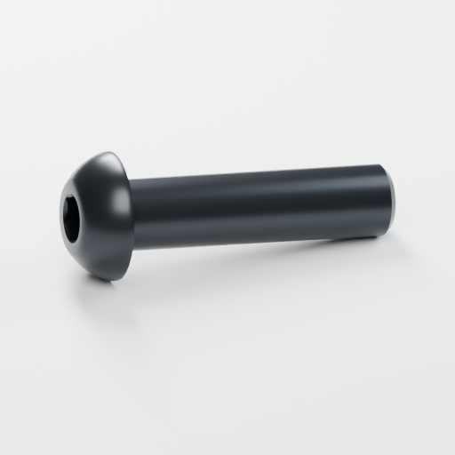

<!-- oomp-documentation:start -->
# OOMP screws

## Summary

Screw families and sizes, drawings and generated models.

Representative example: Hardware Screw Button Head Hex Head Black M2 5 Diameter 10 Mm Length. Other variants differ.

## Details

[OOMP version 5 directory](https://github.com/oomlout/oomlout_oomp_version_5) · [Generator and maintenance guide](README_GENERATOR.md)

## Parts

Browse **833 records** in the [part folders](parts/).

## Assembly

Choose an exact record before using its files. Installation and compatibility depend on the selected component; refer to its technical notes.
<!-- oomp-documentation:end -->
