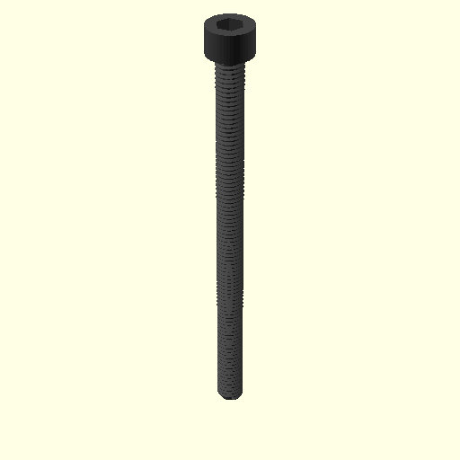
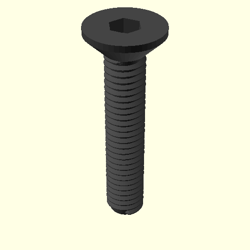

# oomp_hardware_screw_version_5

Generated screw part definitions and 3D outputs for the OOMLout/OOBB hardware catalog.

## Overview

This repository stores a catalog of screw variants and the generated files that go with them. The source data in `parts_source/` defines the screw families and sizes, and the generated `parts/` folders contain metadata, OpenSCAD files, preview images, and, for some parts, STL exports.

This repository is part of the larger [oomlout_oomp_version_5](https://github.com/oomlout/oomlout_oomp_version_5) toolchain for building reusable hardware part libraries, rather than a standalone Python package.

## Example Images

Navigation preview:



Example generated parts:




## Quick Start

If you only want to browse the generated outputs, start in:

- `parts/` for per-part folders
- `navigation_oobb/` for a generated navigation tree

If you have the external OOMLout dependencies installed locally, the main entry points in this repo are:

```bash
python working.py
python action_make_all.py
```

From the source files, `working.py` orchestrates the populate, metadata, SVG, SCAD, and action steps.

## Parametric screw models

`working_oomp_populate.py` attaches `three_d_model_details` to all 870 catalogue
entries. Both source and generated `working.yaml` files contain either a complete
sourced recipe, a specific dimension request, or the explicit thread-forming
exclusion. `working.py` runs `working_three_d_model.py` after metadata and SVG
generation. Ready models use the same materials, studio and output contract.
See [THREE_D_MODELS.md](THREE_D_MODELS.md) for family coverage, standard choices,
batch commands, specification gaps and instructions for adding another family.

Supplier data is copied from `C:\od\OneDrive\docs\project_bolt_web_scraper\data`
into `source_file/supplier_data/` by running `action_update_from_scraper.bat`
(or `python working_supplier_data.py`).
Part population reads these local snapshots and writes a `supplier_data` mapping
into each matching part's `working.yaml`, keyed by supplier name. Each record
includes the supplier part number and product URL; harvested records also include
stock, pack, VAT, capture metadata and the exact-precision price columns. The
`tiers` and `warnings` columns are decoded as lists, while prices remain strings
so their decimal precision is preserved. The source scraper files are read-only.

Install the independent model dependencies and build existing parts:

```powershell
python -m pip install -r requirements-three-d-model.txt
action_prepare_three_d_model.bat
action_make_socket_cap_three_d_model.bat
```

Studio rendering also requires **Blender 4.5 or newer**. The generator finds
Blender on PATH or in the usual Windows/macOS install folders. For another
location, set `OOMP_BLENDER_EXE` to the Blender executable. Cycles uses an available
GPU (OptiX/CUDA first) and falls back to the CPU. NVIDIA OptiX also accelerates
denoising; GPU renders limit CPU preparation to four threads per worker.

Build one part or just migrate its metadata:

```powershell
python working_three_d_model.py --filter hardware_screw_countersunk_hex_head_black_m3_diameter_12_mm_length
python working_three_d_model.py --update-metadata --metadata-only
```

Each `parts/<part_id>/three_d_model/` contains:

- `model.py` and `parameters.json`: a standalone parametric Python model and its
  complete geometry inputs, standards references and modelling choices.
- `model_full.stl` / `model_full.glb`: the detailed solid with a single-start
  right-hand helical thread, 60° flanks, rounded roots, head rim, under-head fillet,
  recessed drive, tip chamfer/point and applicable thread runout. Cup-point set
  screws have a headless threaded body and independent cavities at each end.
- `model_display.stl` / `model_display.glb`: a smaller mesh with a smooth nominal
  thread envelope and the same head, socket and overall dimensions.
- `render_low.png`: 512 × 512 isometric render of the display model.
- `render_high.png`: 2048 × 2048 isometric render of the full model.
- `render_product_low.png` / `render_product_high.png`: 512 / 2048 square product
  photographs with the screw lying on its side, showing the socket and shaft.
- `studio.blend`: editable Blender studio with separate isometric and product
  scenes, material, cameras, softboxes and seamless floor.
- `render_scene.json`: renderer version, material/environment settings, cameras
  and the side pose's measured floor contacts.
- `full/` and `display/`: hidden-line SVGs in **isometric, front, back, left,
  right, top and bottom** views, projected from the actual solid. Isometric axes
  have equal foreshortening; SVG coordinates and physical sizes are millimetres.
- `manifest.json`: artifact hashes, mesh dimensions, volume, triangle counts,
  watertightness and connected-solid counts. Complete existing builds are skipped, even after recipe or code changes.
  Missing assets regenerate while existing PNG renders are preserved. Use `--force`
  to refresh existing outputs or repair damaged files.

For a faster batch, add `--jobs 3` to the generator command. Workers write to
different part folders. The normal pipeline defaults to one worker; set
`model_jobs=3` in `working.run(...)` to use three.

STL uses millimetres with the tip at Z=0 and the head at Z=overall length. GLB
follows glTF 2.0: **metres and Y-up**, with a PBR material for embedding in a web
viewer. These are tessellated solids; there is no STEP/B-rep export in this stage.
Both variants are checked for a single connected, watertight solid before export.
Rendering runs Blender/Cycles in the background. The original orthographic
isometric camera direction remains `(1, -1, 1)`. The side pose is solved from the
actual mesh so the head rim and shaft rest on the floor. Three rectangular
softboxes, a neutral environment and a matte white seamless floor provide
reflections, soft shadows and contact shading. Black oxide steel uses a
Principled material with subtle procedural roughness and sub-micron bump detail;
the finish is a visual approximation of the catalogue's black colour.

Each working YAML recipe includes `material`, `studio` and four `renders`.
Customize these settings per part to change the finish, lights, camera framing,
sample counts or resolutions. The GLB uses the same base colour (converted to
linear glTF factors), metallic and roughness values, plus a light clearcoat via
`KHR_materials_clearcoat`; its appearance depends on the embedding viewer's
environment. Procedural microtexture is retained in the Blender studio.
Add this presentation setup to old recipes without resetting custom geometry:

```powershell
python working_three_d_model.py --update-presentation
```

The sourced table is `source_file/standards/din_7991.yaml`. M3 and M4 use the
**DIN 7991:1986** dimensions (M3: 6 mm head, 1.7 mm maximum head height; M4: 8 mm
head, 2.3 mm maximum head height), not the different ISO 10642 dimensions. Socket
width and depth use midpoints of the DIN permitted limits. The approximate DIN
rim reference is reduced to fit the tangent fillet within the maximum head height.
The model selects a
45° end chamfer of half a pitch and a permissible flat-bottom hex recess.
DIN partial-thread defaults start at 25 mm overall length for M3 and 30 mm for M4;
the full-thread lengths are 12 mm and 14 mm respectively, followed by a one-pitch
runout. Head height is included in the DIN grip/shank length convention.

**M2 is a supplier extension outside DIN 7991's M3–M24 scope.** It uses the
published Bossard BN 20 / Newstar dimensions: 0.4 mm pitch, 4 mm head, 1.2 mm
height, 1.3 mm hex and 0.75 mm penetration. M2 rim/fillet choices are explicitly
identified as model choices. Short M3/M4 screws and extended M3 lengths use
supplier-supported lengths with the DIN head geometry. Metadata distinguishes
standard dimensions, supplier extensions and lengths outside the standard table.

The full model uses nominal metric thread geometry without ISO 965 tolerance
offsets. Manufacturer/property-class stamps are omitted because the catalogue
does not supply those identities. Source URLs, dimension limits and every
modelling choice are persisted; these models do not certify manufactured parts.

To modify an individual model independently, edit its `parameters.json`, or change
overall length with automatic thread/shank recalculation:

```powershell
python parts/hardware_screw_countersunk_hex_head_black_m3_diameter_12_mm_length/three_d_model/model.py --length 30 --output custom_model
```

This standalone command exports both STL/GLB variants. Use the repository generator
for the complete renders and SVG set. To customize catalogue models, edit their
`three_d_model_details` recipes and run the generator **without** `--update-metadata`,
which intentionally restores the sourced defaults. Skip this stage during a full
pipeline run with `working.run(run_three_d_model=False, ...)`.

Windows batch shortcuts (run from any folder):

```bat
action_delete_three_d_model.bat
action_make_three_d_model.bat
```

The delete shortcut removes `parts/*/three_d_model/` and preserves the working
YAML recipes. Preview the deletions with `action_delete_three_d_model.bat -WhatIf`.
Keep its companion `action_delete_three_d_model.ps1` beside the batch file.
The make shortcut adds missing presentation settings and fills missing outputs for
ready model recipes with one worker, including both model variants, studio
isometric and side product PNG renders, Blender scenes and SVG views. It preserves
recipe customizations. Extra generator options can be appended, for example
`action_make_three_d_model.bat --jobs 3`. Add `--force` to rebuild existing renders.
Pending/excluded entries are reported.

Checks: `python -m pytest tests webserver/tests -q`.

## Per-part screw diagrams

Population attaches `svg_details` to every screw definition. The local
`working_svg.py` stage reads these persisted recipes after OOMP creates the
part folders and saves `diagram_threaded.svg`, `diagram_plain.svg` and
`diagram_solid.svg` in each `parts/<full_oomp_id>/` folder. All variants share
the same length-specific profile; the threaded variant adds constant-pitch
marks. Line drawings show the drive geometry inside a circle beside the screw;
solid drawings use a filled silhouette and the filled drive geometry alone.
Hex, Phillips and Pozidriv glyphs follow the part's stored drive type.
New parts and sizes
are included automatically on the next `python working.py` run.

These are schematic side elevations in millimetres. Countersunk length includes
the head; other headed screws use length below the head. Appearance is loaded
dynamically from the shared working_svg `project_bolt` stylesheet using `opsvg`.
The `hardware-diagram` group contains native millimetre paths for consumers,
with identity, dimensions, drive type and variant recorded in SVG metadata.
`profile_bounds` describes the screw alone; `artwork_bounds` includes the drive
symbol and should be used by consumers to centre and fit the complete artwork.
Solid fills resolve dynamically through the `diagram.solid` stylesheet style.

Regenerate saved recipes without CAD work:

```powershell
python working_svg.py
```

To add recipes to existing metadata without running full population:

```powershell
python working_svg_screw_diagrams.py --update-metadata --filter "hardware_screw_countersunk_hex_head_black_m2_diameter_*"
```

The migration changes only `svg_details` in `parts_source` and `parts` metadata.
Normal population defines recipes in `working_oomp_populate.py`; customize
profiles in `working_svg_screw_diagrams.py`.

## Repository Structure

```text
.
├── action_make_all.py         # convenience entry point for the full generation flow
├── working.py                 # main orchestration script
├── working_oomp_populate.py   # defines the screw variants to generate
├── working_oomp.py            # builds part folders from parts_source
├── working_scad.py            # generates screw geometry and SCAD outputs
├── scad_help.py               # SCAD generation and navigation helpers
├── parts_source/              # source definitions, one folder per screw variant
├── parts/                     # generated per-part outputs and metadata
├── navigation_oobb/           # generated navigation copy of selected outputs
└── source_file/               # templates and supporting source files
```

## Examples

Each generated part folder typically includes files such as:

- `working.yaml` for part metadata
- `thing.yaml` for the fuller generated object description
- `3dpr.scad` for the OpenSCAD source
- `3dpr.png` for a rendered preview
- `3dpr.stl` for printable geometry when STL export has been generated
- `label_oomp.svg` and `initial_generated_icon.png` for labeling/artwork assets

Example part folders:

- `parts/hardware_screw_countersunk_hex_head_black_m3_diameter_16_mm_length/`
- `parts/hardware_screw_socket_cap_hex_head_black_m6_diameter_90_mm_length/`

## Requirements

The independent parametric model pipeline uses `requirements-three-d-model.txt`
and Blender for studio rendering. The wider repository workflow additionally
uses the dependencies below.

From the Python imports, regeneration appears to depend on:

- Python
- `PyYAML`
- OOMLout OOMP modules such as `oomp`, `oomp_helper`, and `oomp_populate_helper` from [oomlout_oomp_version_5](https://github.com/oomlout/oomlout_oomp_version_5)
- `oomlout_roboclick` from [oomlout_oomlout_roboclick](https://github.com/oomlout/oomlout_roboclick)
- `oobb` from [oomlout_oobb_version_5](https://github.com/oomlout/oomlout_oobb_version_5)

The generated SCAD workflow also appears to rely on the wider OOBB/BOSL2/OpenSCAD environment referenced by the output files.

## Development Notes

- `parts_source/` currently contains 870 source part folders.
- `parts/` currently contains 870 generated part folders.
- `working_oomp_populate.py` is where the screw size/style combinations are enumerated.
- `working_scad.py` loads generated `working.yaml` files from `parts/` and builds the part geometry.
- `scad_help.py` also creates the `navigation_oobb/` tree used for browsing generated outputs.

## License

No license file was found in this repository.
